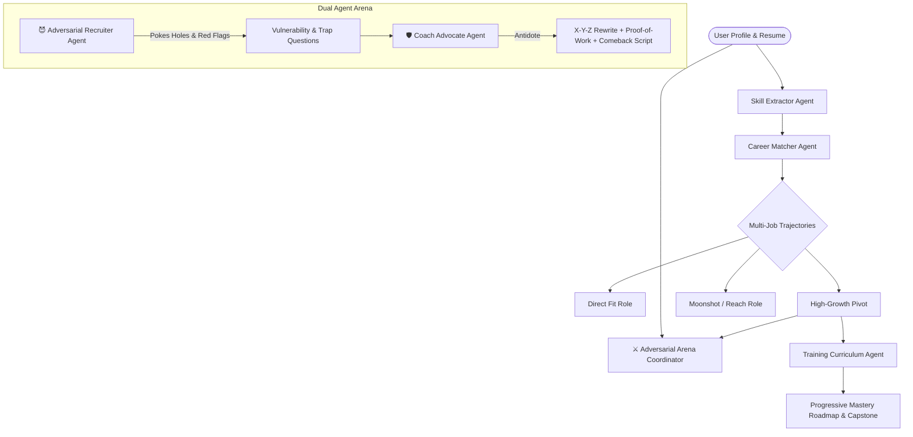

# DeLuLu-VibeCoders
24 hr hackathon repo 
# 🛡️ AI Career Coach & Adversarial Recruiter Platform

An advanced multi-agent AI system designed to assess technical competencies, map comparative career trajectories, stress-test your portfolio against a ruthless **Adversarial Recruiter**, and architect verifiable **Proof-of-Work** training roadmaps.

---

## 🌟 Key Innovations

### 1. ⚔️ The Adversarial Recruiter vs. Coach Advocate Arena
Standard AI career tools give overly polite, generic advice (*"Your resume looks great! Learn Docker!"*). In reality, top-tier recruiters, hiring managers, and tech leads are ruthlessly skeptical:
- **😈 The Adversarial Recruiter (The Skeptic)**:
  - Exposes **Tutorial Clone Traps** (e.g., standard LangChain demo code with zero production hardening).
  - Pokes holes in **Vague Metrics** and unsubstantiated scale claims.
  - Generates a **Skepticism Score (1-100)**, flags hiring red flags, and launches **brutal trap interview questions**.
- **🛡️ The Career Coach (The Advocate)**:
  - Deploys the **Google X-Y-Z Resume Formula** (`Accomplished [X] as measured by [Y] by doing [Z]`).
  - Prescribes concrete **Proof-of-Work Artifacts** (e.g., load-test benchmark scripts, open-source pull requests, architectural case studies).
  - Supplies **word-for-word interview comeback scripts** so you never freeze under pressure.
- **🎤 Live Stress Interview Simulation**:
  - Select any trap question, submit your spoken/typed response, and get immediate adversarial grading and coach delivery upgrades.

---

### 2. 🎯 Multi-Job Trajectory Engine
Instead of suggesting a single role, the system simultaneously models three career vectors:
1. **Direct Fit (80-95% match)**: Immediate promotion or lateral move with 2-3 weeks prep.
2. **High-Growth Pivot (65-80% match)**: High-demand emerging sectors (e.g., AI Systems, MLOps, Distributed Cloud).
3. **Moonshot / High Upside (50-65% match)**: High-leverage leadership or staff architect positions with transformative compensation.

---

### 3. 🚀 Progressive Skill Mastery & Proof-of-Work Roadmaps
Replaces passive video-watching with hands-on, battle-tested engineering milestones:
- **Under-the-Hood Theory**: Concepts interviewers grill you on (memory fragmentation, distributed locks, query planners).
- **Proof-of-Work Projects**: Quantifiable deliverables with tech stack specs and verification benchmarks (e.g., `<50ms p95 latency at 500 RPS`).
- **Boss-Level Interview Drills**: Real scenario questions from Tier-1 tech screens.
- **Ultimate Capstone Deliverable**: GitHub-ready architecture specification.

---

## 🏛️ System Architecture



---

## 📂 Project Structure

```
ai-career-coach/
├── app.py                      # Interactive Streamlit Web Application
├── requirements.txt            # Python dependencies
├── .env.example                # API key template
├── core/
│   ├── config.py               # Environment configuration
│   ├── schemas.py              # Pydantic data models
│   └── llm_provider.py         # Gemini / OpenAI / Anthropic caller + High-Fidelity Simulator
├── agents/
│   ├── skill_extractor.py      # Extracts skills, assesses depth, flags hidden strengths
│   ├── career_matcher.py       # Multi-job comparative pathways & gap analysis
│   ├── adversarial_recruiter.py# Skeptical Recruiter & Coach Advocate arena
│   └── training_curriculum.py  # Progressive project-first learning roadmap generator
└── data/
    └── sample_profiles.json    # 1-click test profiles (Backend Dev, Data Analyst, Full-Stack)
```

---

## 🚀 Quickstart & Execution

### 1. Install Dependencies
```bash
pip install -r requirements.txt
```

### 2. Run the Application
```bash
streamlit run app.py
```

> **Note:** The application includes a **High-Fidelity Heuristic Engine** enabled by default. You can test all features end-to-end immediately without needing an API key! To connect live models, simply enter your Gemini or OpenAI API key in the sidebar.
